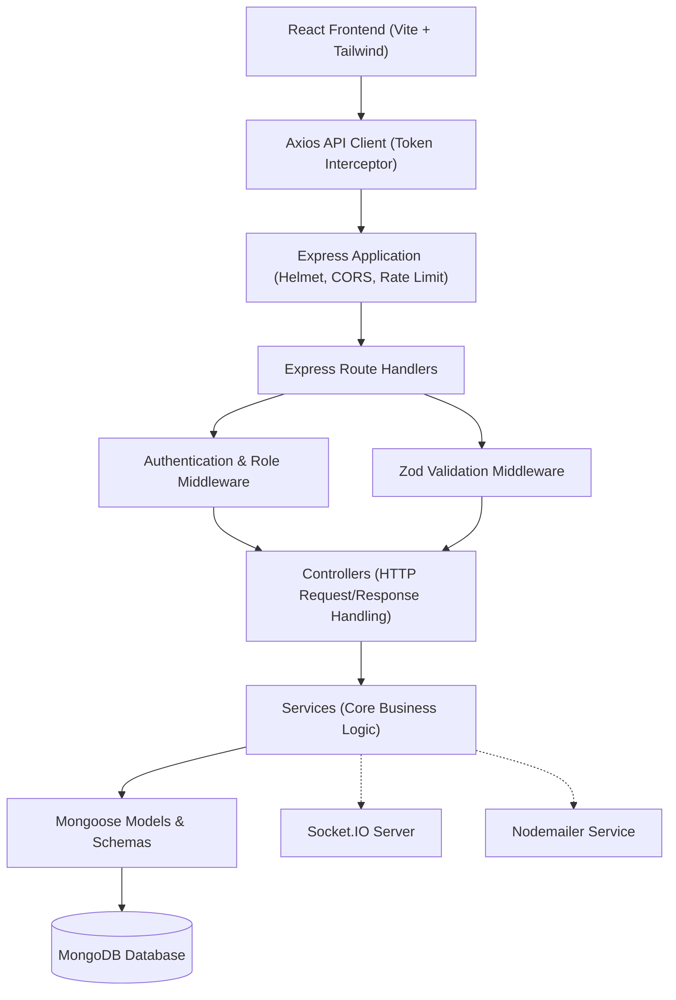
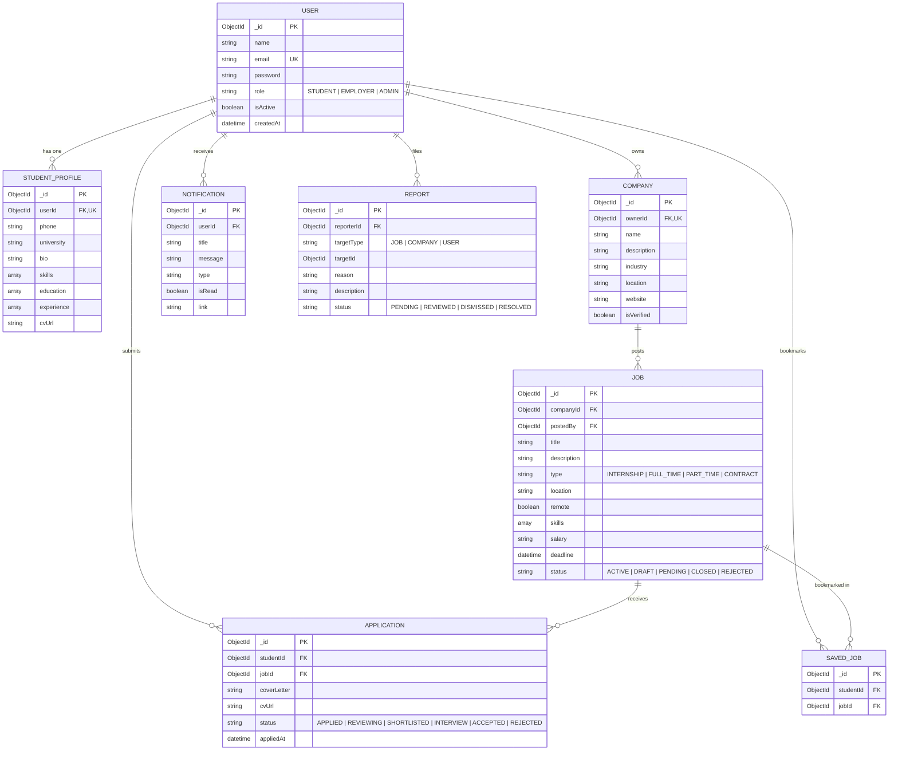

# InternHub — Full-Stack MERN Internship Platform

InternHub is a production-grade, full-stack MERN application connecting students seeking internship and entry-level career opportunities with employers and recruiters. The platform delivers an end-to-end recruitment lifecycle with role-based access control for **Students**, **Employers**, and **Administrators**, real-time notifications via Socket.IO, an AI-powered skill matching engine, resume uploads, and administrative moderation tools.

Built with clean, scalable, and modular layered software architecture:
`React Client → REST API → Routes → Middleware → Controllers → Services → Mongoose Models → MongoDB`.

---

## 📋 Table of Contents

- [Features](#-features)
  - [Student Features](#student-features)
  - [Employer Features](#employer-features)
  - [Administrator Features](#administrator-features)
  - [Core Platform Capabilities](#core-platform-capabilities)
- [Tech Stack](#-tech-stack)
- [System Architecture](#-system-architecture)
- [Database Design & ERD](#-database-design--erd)
- [REST API Documentation](#-rest-api-documentation)
- [Security & Resilience](#-security--resilience)
- [Environment Variables](#-environment-variables)
- [Getting Started & Local Setup](#-getting-started--local-setup)
  - [Standard Setup (Node.js & MongoDB)](#standard-setup-nodejs--mongodb)
  - [Docker Setup (Docker Compose)](#docker-setup-docker-compose)
- [Automated & Manual Testing](#-automated--manual-testing)
- [Production Deployment Guide](#-production-deployment-guide)
- [Roadmap & Future Enhancements](#-roadmap--future-enhancements)
- [License](#-license)

---

## ✨ Features

### Student Features
- **Profile Management**: Maintain comprehensive personal details, contact information, education history, work experience, and technical skill tags.
- **Resume / CV Upload**: Upload PDF/DOCX resumes directly to local server storage or cloud CDN with automatic profile association and instant downloads.
- **Job Discovery & Search**: Full-text keyword search across titles, descriptions, and required skills. Filter by employment type (`INTERNSHIP`, `FULL_TIME`, `PART_TIME`, `CONTRACT`), remote work availability, and location.
- **AI Skill Match Engine**: Instant match percentage score (e.g., `92% Match`) calculated from profile skill overlap with job criteria, complete with matching skill badges.
- **Saved Jobs & Bookmarks**: Save listings to a personal shortlist with duplicate bookmark prevention.
- **Application Tracking**: Submit applications with personalized cover letters, monitor real-time review stages (`APPLIED`, `REVIEWING`, `SHORTLISTED`, `INTERVIEW`, `ACCEPTED`, `REJECTED`), and view complete submission history.
- **Live Notifications**: Receive real-time alerts when application status changes or interviews are scheduled.

### Employer Features
- **Company Profile**: Create and manage company brand identity, logo, industry classification, size, headquarters, and website.
- **Job Posting Lifecycle**: Create, edit, draft, activate, close, and delete job postings with deadline dates and skill tags.
- **Applicant Review Pipeline**: Dedicated applicant dashboard per job or across all postings. Filter candidates by status, inspect candidate profiles, read cover letters, and download candidate resumes.
- **Candidate Stage Updates**: Promote or reject candidate applications with automatic real-time WebSocket alerts and email notifications.
- **Recruitment Analytics**: Track total active listings, candidate pipeline volume, review ratios, and interview counts.

### Administrator Features
- **Platform Analytics**: Dashboard displaying platform health, total registered users, employer-to-student ratios, active jobs, pending approvals, and reported items.
- **User Management**: View all platform users, filter by role, and activate or suspend suspicious accounts.
- **Job Moderation**: Review pending job postings and approve or reject submissions before public visibility.
- **Company Verification**: Review and verify legitimate employer company profiles.
- **Report & Abuse Resolution**: Review flagged reports on jobs, companies, or users, update report status (`REVIEWED`, `RESOLVED`, `DISMISSED`), and take disciplinary action.

### Core Platform Capabilities
- **Strict Role-Based Access Control (RBAC)**: Backend verification guarantees that authenticated roles cannot be tampered with by client payloads.
- **Real-Time WebSockets**: Socket.IO server pushes live notification events to individual user rooms without polling overhead.
- **Automated Email Notifications**: HTML emails dispatched upon application submission and stage transitions (with development logging fallback).

---

## 🛠 Tech Stack

| Layer | Technology | Description |
| :--- | :--- | :--- |
| **Frontend** | React 18 | Declarative component UI |
| **Build Tool** | Vite | Lightning-fast development & production bundling |
| **Styling** | Tailwind CSS | Utility-first responsive design system |
| **Routing** | React Router v6 | Client-side routing with role-based protected routes |
| **HTTP Client** | Axios | Request/response interceptors for JWT injection & error parsing |
| **Validation** | Zod + React Hook Form | Schema-driven form handling and input validation |
| **Icons** | Lucide React | Modern, clean UI iconography |
| **Backend** | Node.js (ES Modules) | Asynchronous JavaScript runtime |
| **Server Framework** | Express.js | Modular REST API routing and middleware pipeline |
| **Database** | MongoDB & Mongoose ODM | Document database with schema validation & indexing |
| **Authentication** | JWT & bcryptjs | Stateless JSON Web Tokens & salted password hashing |
| **File Handling** | Multer | Multi-part form-data parsing with disk storage and MIME validation |
| **Real-time** | Socket.IO | Bi-directional WebSocket communication for live alerts |
| **Email Service** | Nodemailer | Automated transactional HTML email notifications |
| **Security** | Helmet & Rate Limit | Secure HTTP headers and brute-force mitigation |
| **Containerization** | Docker & Compose | Multi-container production deployment |

---

## 🏗 System Architecture

InternHub enforces strict separation of concerns across all layers of the application:



---

## 🗄 Database Design & ERD



### Database Indexes for High Performance
- **Users**: Unique index on `email`.
- **Student Profile**: Unique index on `userId`.
- **Company**: Unique index on `ownerId`; compound index on `{ name: 1, industry: 1 }`.
- **Jobs**: Full-text index on `{ title: "text", description: "text", skills: "text" }`; compound index on `{ status: 1, type: 1, remote: 1 }`.
- **Applications**: Compound unique index on `{ studentId: 1, jobId: 1 }` (guarantees a student can never submit duplicate applications for the same role).
- **Saved Jobs**: Compound unique index on `{ studentId: 1, jobId: 1 }` (prevents duplicate bookmarks).
- **Notifications**: Compound index on `{ userId: 1, isRead: 1, createdAt: -1 }`.
- **Reports**: Index on `{ status: 1, targetType: 1, createdAt: -1 }`.

---

## 📡 REST API Documentation

Base URL: `http://localhost:5000/api`

### 1. Authentication Endpoints (`/api/auth`)
| Method | Endpoint | Access | Description |
| :--- | :--- | :--- | :--- |
| `POST` | `/api/auth/register` | Public | Register new user (`STUDENT`, `EMPLOYER`, `ADMIN`) |
| `POST` | `/api/auth/login` | Public | Authenticate user & return JWT token |
| `GET` | `/api/auth/me` | Protected | Fetch current authenticated user session |
| `POST` | `/api/auth/logout` | Protected | Client session logout |

### 2. User & Profile Endpoints (`/api/users`)
| Method | Endpoint | Access | Description |
| :--- | :--- | :--- | :--- |
| `GET` | `/api/users/me` | Protected | Fetch authenticated student profile |
| `PUT` | `/api/users/me` | Protected (Student) | Update student bio, education, skills, experience |
| `POST` | `/api/users/me/upload-cv` | Protected (Student) | Upload resume PDF/DOCX (`multipart/form-data`) |
| `GET` | `/api/users/me/saved-jobs` | Protected (Student) | Retrieve all bookmarked jobs |

### 3. Job Endpoints (`/api/jobs`)
| Method | Endpoint | Access | Description |
| :--- | :--- | :--- | :--- |
| `GET` | `/api/jobs` | Public | Search & filter jobs with pagination |
| `GET` | `/api/jobs/:id` | Public | Get detailed single job listing |
| `GET` | `/api/jobs/recommended`| Protected (Student) | AI skill match recommendations |
| `POST` | `/api/jobs` | Protected (Employer) | Create new job posting |
| `PUT` | `/api/jobs/:id` | Protected (Employer) | Update existing job posting |
| `DELETE`| `/api/jobs/:id` | Protected (Employer) | Delete job posting |
| `PATCH`| `/api/jobs/:id/status` | Protected (Employer) | Toggle job status (`ACTIVE`, `CLOSED`, `DRAFT`) |
| `POST` | `/api/jobs/:id/save` | Protected (Student) | Bookmark / save job |
| `DELETE`| `/api/jobs/:id/save` | Protected (Student) | Remove saved job bookmark |

### 4. Application Endpoints (`/api/applications`)
| Method | Endpoint | Access | Description |
| :--- | :--- | :--- | :--- |
| `POST` | `/api/applications` | Protected (Student) | Submit application with cover letter & CV |
| `GET` | `/api/applications/my` | Protected (Student) | View student submitted applications |
| `GET` | `/api/applications/employer/applicants`| Protected (Employer) | View candidates for employer jobs |
| `PATCH`| `/api/applications/:id/status` | Protected (Employer) | Update candidate status (`ACCEPTED`, `REJECTED`, etc.) |

### 5. Company Endpoints (`/api/companies`)
| Method | Endpoint | Access | Description |
| :--- | :--- | :--- | :--- |
| `GET` | `/api/companies/:id` | Public | View public company profile |
| `GET` | `/api/companies/my` | Protected (Employer) | Get authenticated employer's company profile |
| `PUT` | `/api/companies/my` | Protected (Employer) | Create or update company profile |

### 6. Notification Endpoints (`/api/notifications`)
| Method | Endpoint | Access | Description |
| :--- | :--- | :--- | :--- |
| `GET` | `/api/notifications` | Protected | Get unread/read user notifications |
| `PATCH`| `/api/notifications/:id/read` | Protected | Mark specific notification as read |
| `PATCH`| `/api/notifications/read-all` | Protected | Mark all user notifications as read |

### 7. Administrative Endpoints (`/api/admin`)
| Method | Endpoint | Access | Description |
| :--- | :--- | :--- | :--- |
| `GET` | `/api/admin/stats` | Protected (Admin) | Retrieve platform-wide metrics & counts |
| `GET` | `/api/admin/users` | Protected (Admin) | List and filter all platform users |
| `PATCH`| `/api/admin/users/:id/status` | Protected (Admin) | Toggle user active/suspended status |
| `GET` | `/api/admin/jobs` | Protected (Admin) | Moderation view of all jobs |
| `PATCH`| `/api/admin/jobs/:id/approval`| Protected (Admin) | Approve or reject job posting |
| `GET` | `/api/admin/companies` | Protected (Admin) | Moderation view of companies |
| `PATCH`| `/api/admin/companies/:id/verify` | Protected (Admin) | Toggle company verification badge |
| `GET` | `/api/admin/reports` | Protected (Admin) | Retrieve user reports |
| `PATCH`| `/api/admin/reports/:id/status` | Protected (Admin) | Update report status |

---

## 🔒 Security & Resilience

- **Rate Limiting**: Configured `express-rate-limit` protecting `/api/auth` (max 20 attempts/15 min) to prevent credential stuffing and brute-force attacks, alongside general API rate limits.
- **Secure Headers**: `helmet` configured with strict Content Security Policies and cross-origin resource policies for uploaded files.
- **Sanitized Passwords**: Passwords hashed with `bcryptjs` (salt rounds: 10) and excluded from Mongoose queries by default using `select: false`.
- **JWT Authentication**: Signed JWT tokens stored in client memory/headers with explicit expiration (`7d`).
- **Input Validation**: Strict Zod schema parsing on all request bodies, rejecting unpermitted data types before reaching controllers.
- **Error Shielding**: Centralized `ApiError` and `errorHandler` middleware removes stack traces in production to prevent information leakage.
- **Query Hardening**: Mongoose sanitizes object queries against NoSQL injection.

---

## ⚙️ Environment Variables

Create `.env` inside the `server/` directory:

| Variable | Required | Default / Example | Purpose |
| :--- | :---: | :--- | :--- |
| `PORT` | No | `5000` | HTTP port for Node.js API |
| `NODE_ENV` | Yes | `development` / `production` | App runtime environment |
| `CLIENT_URL` | Yes | `http://localhost:5173` | Allowed CORS frontend origin |
| `MONGO_URI` | Yes | `mongodb://127.0.0.1:27017/internhub` | MongoDB connection string |
| `JWT_SECRET` | Yes | `super_secret_jwt_key_internhub_2026` | Secret key for signing JWT tokens |
| `JWT_EXPIRES_IN`| No | `7d` | Token lifetime |
| `CLOUDINARY_CLOUD_NAME` | Optional | `your_cloud_name` | Cloud storage account |
| `CLOUDINARY_API_KEY` | Optional | `your_api_key` | Cloud storage API key |
| `CLOUDINARY_API_SECRET` | Optional | `your_api_secret` | Cloud storage API secret |
| `EMAIL_HOST` | Optional | `smtp.mailtrap.io` | SMTP server host for notifications |
| `EMAIL_PORT` | Optional | `587` | SMTP server port |
| `EMAIL_USER` | Optional | `your_smtp_username` | SMTP account username |
| `EMAIL_PASSWORD` | Optional | `your_smtp_password` | SMTP account password |

---

## 🚀 Getting Started & Local Setup

### Standard Setup (Node.js & MongoDB)

#### 1. Clone & Install Dependencies
```bash
git clone https://github.com/your-username/internhub.git
cd internhub

# Install all root, server, and client dependencies
npm run install:all
```

#### 2. Configure Environment Variables
Copy the sample environment file in the `server` folder:
```bash
cp server/.env.example server/.env
```

#### 3. Run Development Servers
Start both backend and frontend concurrently:
```bash
npm run dev
```
* **Frontend UI**: [http://localhost:5173](http://localhost:5173)
* **Backend REST API**: [http://localhost:5000/api](http://localhost:5000/api)
* **API Health Check**: [http://localhost:5000/api/health](http://localhost:5000/api/health)

---

### Docker Setup (Docker Compose)

Run the entire application (React frontend, Node.js backend, and MongoDB database) inside isolated Docker containers with a single command:

```bash
docker compose up --build
```

Access the platform:
* **Web Application**: [http://localhost](http://localhost) (Port 80)
* **REST API**: [http://localhost:5000/api](http://localhost:5000/api)

To stop and remove containers:
```bash
docker compose down
```

---

## 🧪 Automated & Manual Testing

### Automated Test Suite
InternHub includes an automated test suite verifying security utilities, Zod validation schemas, role authorization middlewares, and HTTP endpoints.

Run the test suite using Node's native test runner:
```bash
npm test
```

Test Results Output:
```text
✔ InternHub Production Test Suite
  ✔ Security & Utility Functions
    ✔ should hash a password and correctly verify it with bcrypt
    ✔ should generate a valid JWT token with user ID and role
    ✔ should create standardized ApiError instances with custom status and payload
  ✔ Zod Request Validation Schemas
    ✔ should validate a valid registration payload
    ✔ should reject registration when email format is invalid
    ✔ should reject registration when password is shorter than 6 characters
    ✔ should reject unknown roles outside STUDENT, EMPLOYER, ADMIN
    ✔ should validate login credentials schema correctly
  ✔ Role-Based Authorization Middleware
    ✔ should grant access when user role matches authorized roles
    ✔ should deny access with 403 Forbidden when user role is not authorized
    ✔ should deny access with 401 Unauthorized when user context is missing
  ✔ HTTP REST API & Security Handlers
    ✔ GET /api/health should return 200 and healthy status
    ✔ GET /api should return 200 and root directory information
    ✔ GET /non-existent-route should return standardized 404 ApiError
    ✔ POST /api/auth/register with empty body should return 400 Bad Request
    ✔ POST /api/auth/login with invalid email format should return 400 Bad Request
    ✔ GET /api/auth/me without Bearer token should return 401 Unauthorized
    ✔ GET /api/auth/me with invalid or forged token should return 401 Unauthorized
    ✔ POST /api/jobs without authorization header should return 401

ℹ tests 19 | suites 5 | pass 19 | fail 0
```

### Manual Testing Scenarios Checklist
- [x] **Unauthorized Access**: Attempting to query protected endpoints without a token returns `401 Unauthorized`.
- [x] **Role Privilege Isolation**: Students attempting to post jobs receive `403 Forbidden`.
- [x] **Duplicate Application Prevention**: Attempting to submit a second application to the same job returns `400 Bad Request` with database unique index protection.
- [x] **File Upload Validation**: Attempting to upload unsupported file formats (e.g. `.exe`) is rejected by Multer MIME filter.
- [x] **Rate Limiting**: Exceeding 20 authentication attempts triggers `429 Too Many Requests`.

---

## 🌐 Production Deployment Guide

### Option 1: Render / Railway (Backend API)
1. Link your GitHub repository.
2. Set root directory to `server`.
3. Set build command: `npm install`.
4. Set start command: `node src/server.js`.
5. Add production environment variables (`MONGO_URI`, `JWT_SECRET`, `CLIENT_URL`, etc.).

### Option 2: Vercel / Netlify (Frontend Client)
1. Link your GitHub repository.
2. Set root directory to `client`.
3. Build command: `npm run build`.
4. Output directory: `dist`.
5. Set `VITE_API_URL` to your live backend API URL.

### Option 3: MongoDB Atlas (Database)
1. Create a free cluster on [MongoDB Atlas](https://www.mongodb.com/atlas).
2. Create a database user and configure Network Access IP whitelist (`0.0.0.0/0`).
3. Set `MONGO_URI` in your production environment variables.

---

## 🗺 Roadmap & Future Enhancements

- [ ] **OAuth2 Social Sign-In**: Google & GitHub authentication.
- [ ] **Cloudinary Storage Sync**: Direct cloud-native CDN hosting for resumes and company logos.
- [ ] **Video Interview Integration**: Integrated WebRTC video screening between employers and shortlisted students.
- [ ] **Student Portfolio Builder**: Public shareable portfolio links highlighting projects and GitHub statistics.

---

## 📄 License

This project is open-source and available under the [MIT License](LICENSE).
